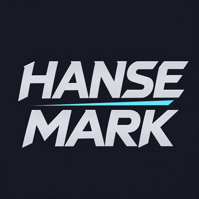

# Hanse Mark

[Deutsche Anleitung](README-DE.md)

Hanse Mark is a customizable world-marker ring for group and raid leaders in **WoW Forever**. Open it near your cursor, choose a symbol and place it on the ground. Version **1.0.0** targets Forever **1.60.1 / Interface 16001** and includes English and German. No additional addons are required.

## Features and appearances

Choose any combination of the eight world markers. Active icons are spaced evenly; presets select none, three, five or all eight. Disabling an icon changes the menu without removing an existing world marker.

Six appearances are included:

- **Alliance:** blue and gold with an ornamental faction frame.
- **Horde:** red and dark metal with an ornamental faction frame.
- **Satin:** a restrained metal ring; the default appearance.
- **Clear:** black rings and sector dividers.
- **Orbit:** black rings and small ticks without sector dividers.
- **Free:** freestanding icons with soft hover feedback.

Adjust ring size, icon size, opacity, marker names, neutral-center size and screen-edge handling. German or English can be selected manually or follow the client language.

## Installation and first start

**CurseForge App:** select your WoW Forever installation/profile, find Hanse Mark and install it. Fully restart WoW after installation, especially when new artwork files are added.

**Manual installation:** close WoW, extract the addon ZIP and copy its `HanseMark` folder into your Forever client's `Interface/AddOns` directory. The resulting file must be:

`<your Forever client folder>/Interface/AddOns/HanseMark/HanseMark.toc`

Avoid a second nested `HanseMark` folder. Start WoW, enable the addon and open **Esc > Options > AddOns > Hanse Mark**, or enter `/hansemark`. Assign a key; none is assigned automatically. Replacing a conflicting binding requires confirmation showing the existing assignment.

## Settings and safe previews

**Interaction** contains the current binding, assignment/removal and click/hold mode. **Markers** contains individual icons and presets. **Appearance** contains the six styles and display controls. **Info** contains language, help, diagnostics and a confirmed settings reset.

The embedded preview updates with your choices. The large preview follows the mouse and never places markers. Its center and outside area select nothing. Closing it returns to the same Hanse Mark settings tab. Enable at least one marker to display a ring preview.

## Placing markers

**Click mode:**

1. Press your assigned key to open the ring.
2. Click the desired visible icon.
3. Move to valid ground and click again to place the marker.

**Hold mode:**

1. Hold your assigned key.
2. Move toward the desired marker and release the key.
3. Click valid ground to place it.

Releasing in the neutral center cancels. Escape or right-click cancels the ring selection. Cancel an already active ground-target reticle with WoW's normal controls before opening another selection. Click mode requires clicking the icon itself; highlighted sectors alone are not click targets.

## Combat, permissions and saved settings

The manual protected workflow supports combat use. WoW still controls group permissions, range and valid ground; the addon does not grant marking rights. A zero-marker selection performs no marker action. Settings and bindings change only outside combat. There is no automatic boss logic or automatic placement.

Appearance and behavior settings use account-wide `HanseMarkDB` within the current WoW client/account. Keybindings use WoW's active binding set. For updates, close WoW and replace the addon folder while preserving saved variables. Existing settings migrate automatically. Confirmed reset restores addon defaults while keeping the binding; binding removal is a separate action.

## Commands and troubleshooting

- `/hansemark` or `/hmark`: open settings.
- `/hansemark diag` or `/hmark diag`: print diagnostics.

No ring: check the binding and enabled markers. No placement: check your group rights and valid ground. Missing artwork: verify the folder structure and fully restart WoW; `/reload` alone may be insufficient for new files. For reports, include addon version, Forever build, language, mode, enabled markers, group role, combat state, reproduction steps and diagnostic output. Remove private information from screenshots.

## Credits and licensing

Developed by **Steve Motzek (Hanse)** with AI-assisted development and artwork. Graphics include AI-generated/edited artwork and programmatically built UI textures. The published style montage is a composition of actual addon textures, **not an in-game screenshot**.

The addon is free to use under its **All Rights Reserved** license. Read `LICENSE.txt` for permissions. Blizzard names, trademarks and client resources remain with their owners. Hanse Mark is an independent fan addon, not affiliated with or endorsed by Blizzard.

[Changelog](CHANGELOG.md) · [License](LICENSE.txt) · [Validation record](docs/VALIDATION.md)

## Source and support / Quellcode und Hilfe

[Source / Quellcode](https://github.com/sierone1/HanseMark) · [Issues / Fehler melden](https://github.com/sierone1/HanseMark/issues)
